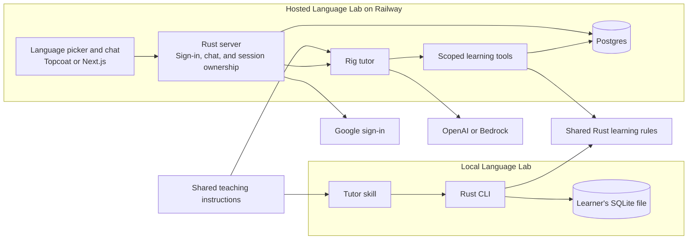
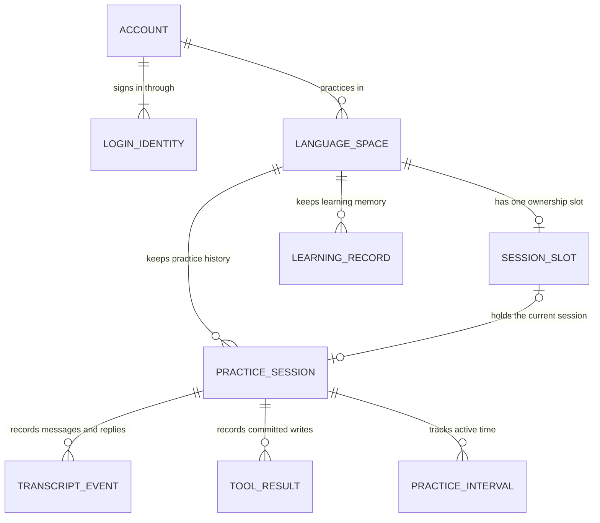
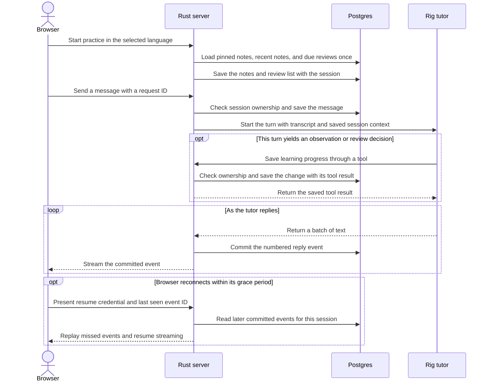
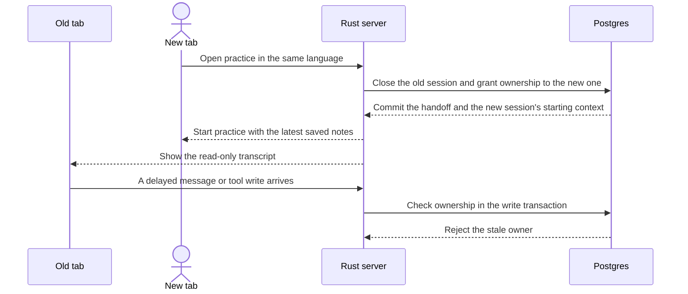

# Hosted tutor

```rfd-metadata
format-version = 1
id = "RFD-hosted-tutor"
title = "Hosted tutor"
status = "draft"
base-revision = "git:173eee5d8ebff5056567c1c4eefdd248d0267b08"
anchor-changes = "proposed"
affects = [
  { target = "design:design/records.md", scope = "current" },
  { target = "design:design/replacement.md", scope = "current" },
  { target = "design:design/scheduling.md", scope = "current" },
  { target = "design:design/queries.md", scope = "current" },
  { target = "design:design/skill.md", scope = "current" },
]
planned = [
  "design:design/hosted-tutor.md",
  "roadmap:hosted-tutor",
  "milestone:hosted-tutor-1",
  "milestone:hosted-tutor-2",
  "milestone:hosted-tutor-3",
  "milestone:hosted-tutor-4",
]
milestones = [
  { target = "milestone:hosted-tutor-1", scope = "proposed" },
  { target = "milestone:hosted-tutor-2", scope = "proposed" },
  { target = "milestone:hosted-tutor-3", scope = "proposed" },
  { target = "milestone:hosted-tutor-4", scope = "proposed" },
]
supersedes = []
sources = []
incorporation = []
```

## Summary

A learner signs in, chooses a language, and practices in a streaming chat.
The tutor plans for a short daily practice session of about 10–15 minutes.
The learner can finish earlier or keep practicing. A fresh chat starts
with an empty transcript and can still use the learner’s notes and
reviews. Opening the same language on another device takes over the
active session.

## Motivation

The local CLI and skill give a tutor persistent learning notes inside an
existing conversation interface. A hosted tutor would give learners a
browser chat with sign-in and preserved transcripts. A conversation can
move between devices or end without warning. The tutor saves learning
progress as practice happens so the next session can pick it up.
[Issue #1](https://github.com/nikomatsakis/language-lab/issues/1)

## Proposal

### Architecture



The [CLI contract](../design/README.md) remains the baseline for local use.
Both versions can use the same Rust code to calculate “review in three days”
in the learner’s timezone. Each database saves related changes together.
For example, splitting a note saves both new notes and retires the original
in one operation. If the save fails, the original stays active. The CLI
skill finds the learner’s selected file and runs commands. In the web app,
the server gives Rig tools to read notes, revise them, and schedule reviews
for the signed-in learner and selected language.

### Data ownership



The diagram shows logical relationships. The proposed Postgres design uses
shared tables keyed by account and exact language. The server derives that
scope for reads, streams, and tool calls. Foreign keys and
continuation cursors are scoped too. Learning records belong to the language
space, so the next chat can use them. Records keep their original content
and identity when retired. The learner's timezone lives on the account.

Google is the first sign-in option. Store the provider's verified issuer
and user ID separately from the Language Lab account. If we support linking
a second sign-in method, the learner proves control of both identities.
Apple documents an existing App Store app with Sign in with Apple as a
prerequisite for web support, along with web domain and callback registration
and a signing key. [Apple’s web sign-in requirements](https://developer.apple.com/documentation/signinwithapple/configuring-your-environment-for-sign-in-with-apple)

### Session start, a teaching turn, and reconnect



The hosted server loads the learning notes and due reviews once per
practice session. It saves that snapshot so later messages and reconnects
can reuse it. Tool results tell the tutor what changed during practice. If
it needs the latest state, such as an updated due list after local
midnight, it can ask through the scoped learning tools.

The tutor’s instructions say to record new learning observations and review
decisions through the tools on the turn that produces them. If the learner
recalls πήγα after a hint, the tutor saves the hint and a reference to the
exact version of the note they practiced. A later split into recognition
and speaking exercises preserves that reference. The tutor can keep, move,
or clear an existing review date, or schedule reviews for the new exercises.

Allow one in-flight teaching turn per session. Retrying a message or tool
write with the same request identity returns its existing result within
the authorized scope. If the server crashes during a reply, mark the saved
prefix as interrupted. The next turn can use the notes already saved.

### Closing and taking over a session



Closing records the final practice duration and marks an unfinished reply
as interrupted. The learner can end practice at any time. A disconnected
session closes when its reconnect window expires. A learner who keeps
practicing past 15 minutes can continue in the same session.

The same database lock orders takeover and interactive writes. A tool write
that commits first is available in the new session’s starting context. If
takeover commits first, the old session’s late write is rejected. Retrying
an open request returns its recorded result. Each distinct open is ordered
by the database, and the most recently admitted session owns the slot.

### Active practice time

Show a timer labeled “Practice time” in the active chat. Start at `0:00`
and count up during active practice. The timer pauses when practice is
idle or disconnected and resumes from the server’s saved total when the
learner reconnects to the same session. A new session starts at `0:00`.

Count foreground, connected practice within a recent-interaction window.
The server timestamps activity, caps gaps, and counts each saved interval
once. Close the interval on disconnect, timeout, takeover, or explicit end.
A dropped connection can be counted through its last confirmed heartbeat.
Idle gaps and replayed events add no practice time.

### UI wireframes

#### Sign in and choose a language

```text
+--------------------------+
| Language Lab             |
|                          |
| [ Continue with Google ] |
+--------------------------+

+--------------------------+
| Choose a language        |
|                          |
| (o) Greek                |
| ( ) French               |
|                          |
| [ Start practice ]       |
+--------------------------+
```

#### Practice chat

```text
+----------------------------------------------+
| Greek              Practice time  07:42      |
|                            [ End practice ]  |
+----------------------------------------------+
| Tutor                                        |
| How would you say “I went home” in Greek?    |
|                                              |
| You                                          |
| Is it πήγα σπίτι?                            |
|                                              |
| Tutor                                        |
| Yes. Πήγα is the past tense of…              |
|                                              |
+----------------------------------------------+
| [ Type a message                    ] [Send] |
+----------------------------------------------+
```

#### Takeover

```text
+-----------------------------------------+
| Greek · Old tab                         |
+-----------------------------------------+
| Practice opened in another tab.         |
| Transcript                              |
| Tutor: How would you say “I went home”? |
| You: Is it πήγα σπίτι?                  |
+-----------------------------------------+

+-----------------------------------------+
| Greek · Active chat                     |
+-----------------------------------------+
| Practice time  0:00                     |
+-----------------------------------------+
```

The new tab starts at `0:00` once the server transfers ownership. The
old tab keeps the transcript visible, with the message field removed.

## Proposed anchors

The hosted proposal adds requirements and anchors for the web experience.
The existing local requirements and anchors continue to govern the CLI.

```rfd-change
operation = "add"
id = "R-hosted-learning-continuity"
reason = "Learners need their progress when they return in a new web chat."
bindings = []
definition = '''
> **`R-hosted-learning-continuity`** (draft): **Learning memory follows the learner**
> Statement: A hosted learner must be able to return to saved learning notes and reviews in a new chat for the same language, with access limited to the signed-in account and selected language.
> Source: Issue #1 and the browser tutoring flow in this proposal.
'''
```

```rfd-change
operation = "add"
id = "R-hosted-practice-recovery"
reason = "Browser and server lifetimes can end independently of a practice session."
bindings = []
definition = '''
> **`R-hosted-practice-recovery`** (draft): **Practice progress survives interruptions**
> Statement: The hosted tutor must preserve committed conversation and learning progress when a device disconnects, takes over, or ends practice, and when the server restarts.
> Source: Issue #1 and the session close and takeover flow in this proposal.
'''
```

```rfd-change
operation = "add"
id = "R-hosted-practice-time"
reason = "A chat can stay open while the learner is away."
bindings = []
definition = '''
> **`R-hosted-practice-time`** (draft): **Practice time reflects active use**
> Statement: The hosted tutor must track how long the learner has actively practiced and show that duration during the session.
> Source: Issue #1 and the active practice time proposal.
'''
```

```rfd-change
operation = "add"
id = "A-hosted-learning-isolation"
reason = "Accounts share the hosted database."
bindings = [{ target = "requirement:R-hosted-learning-continuity", scope = "proposed" }]
definition = '''
> **`A-hosted-learning-isolation`** (draft): **Hosted learning data stays in scope**
> Property: Hosted chat, stream, and tool operations may read or change learning and session data only for their authorized account and exact language.
> Authority: `R-hosted-learning-continuity`
> - Criterion `scope` [test]: Use two accounts and two languages with overlapping record identifiers. Try crossing scope with session IDs, record IDs, and cursors through the service and tools. Assert the foreign data is never delivered or changed and that the tutor’s tools are limited to the scope of its session.
'''
```

```rfd-change
operation = "add"
id = "A-hosted-fresh-learning-memory"
reason = "A new practice session needs the latest saved learning notes and reviews."
bindings = [{ target = "requirement:R-hosted-learning-continuity", scope = "proposed" }]
definition = '''
> **`A-hosted-fresh-learning-memory`** (draft): **Each hosted session starts with current learning memory**
> Property: At practice session start, the server loads and saves the selected language's current pinned notes, recent notes, and due reviews, including learning changes committed by earlier sessions. Later turns and reconnects reuse this snapshot. The tutor can request current learning data through scoped tools.
> Authority: `R-hosted-learning-continuity`
> - Criterion `continuity` [test]: Save a pinned note and a review in one session. Advance the learner's clock across local midnight and open a new session. Verify the initial snapshot includes the saved note and newly due review. Send multiple messages and reconnect, then verify the server reuses the snapshot without repeating the initial learning-data query. Request the current due list through a scoped tool and verify that it reflects intervening changes.
'''
```

```rfd-change
operation = "add"
id = "A-hosted-session-takeover"
reason = "Different devices can try to practice the same language at the same time."
bindings = [{ target = "requirement:R-hosted-practice-recovery", scope = "proposed" }]
definition = '''
> **`A-hosted-session-takeover`** (draft): **One session owns practice for each account and language**
> Property: Only the current practice session can commit interactive writes in its account and language. An open on another device closes the old session and grants write authority to the new owner in the same transaction.
> Authority: `R-hosted-practice-recovery`
> - Criterion `takeover-race` [test]: Race two opens and an old session's delayed writes across server instances. Exercise both commit orders. Verify that a write committed before the handoff is visible in the new session, a write arriving after the handoff fails, and retrying an open cannot retake ownership.
'''
```

```rfd-change
operation = "add"
id = "A-hosted-durable-stream"
reason = "A learner should be able to recover the reply prefix they already saw."
bindings = [{ target = "requirement:R-hosted-practice-recovery", scope = "proposed" }]
definition = '''
> **`A-hosted-durable-stream`** (draft): **Published replies can be replayed**
> Property: The server persists accepted learner messages and assistant text before exposing their effects to the learner. Reconnect within the grace period replays committed reply events after the last seen event ID in order. A crashed turn leaves a readable prefix marked interrupted.
> Authority: `R-hosted-practice-recovery`
> - Criterion `replay` [test]: Drop the browser connection after some reply events and reconnect. Compare order and contents with the saved transcript. Kill the app during a second reply and confirm recovery retains its committed prefix and interruption status. Retry a committed tool invocation and observe the saved result with one mutation.
'''
```

```rfd-change
operation = "add"
id = "A-hosted-active-practice"
reason = "Practice duration must exclude idle and disconnected time."
bindings = [{ target = "requirement:R-hosted-practice-time", scope = "proposed" }]
definition = '''
> **`A-hosted-active-practice`** (draft): **Practice intervals are counted once**
> Property: Hosted practice duration is the total of server-confirmed foreground, connected intervals within the recent-interaction window. Disconnect, timeout, takeover, and explicit end close the interval. Replayed events add no time. The active chat displays this duration as a count-up timer that starts at zero for each new session.
> Authority: `R-hosted-practice-time`
> - Criterion `elapsed-time` [test]: With a controlled clock, send duplicate activity events and exercise idle, background, disconnect, reconnect, takeover, and explicit end. Compare saved duration with the eligible intervals and confirm that a closed session's duration stays fixed.
> - Criterion `visible-timer` [test]: In the browser, verify the practice timer starts at zero, counts up during active use, pauses when idle, and resumes from the saved total after reconnect. Check that a new session starts at zero.
'''
```

## Alternatives

- **End-of-session model pass.** A separate pass could look for missed
  observations but would add a recovery path and make takeover wait for
  a model call. The proposal saves observations during practice.
- **Frontend.** Topcoat could share Rust types and validation. Compare it
  with Next.js using sign-in, stream replay, and takeover feedback.

## Open questions

- Set the idle and reconnect windows and decide whether waiting for a
  reply in the foreground counts as practice.
- Choose the frontend and initial model provider. Decide whether the
  first release includes SQLite import.
- Decide whether Postgres row-level security should enforce scope alongside
  the application. Use shared fixtures to decide which local query
  semantics hosted tools will expose.

## Implementation

The milestones below are proposed. After review, incorporate the agreed
guarantees into the owning design and authority chapters, then record
the milestones and link their evidence to the adopted criteria. The
first proposed experiment uses real Postgres and a scripted tutor to
exercise session ownership and recovery.

| Milestone | Depends on | Evidence to collect |
| --- | --- | --- |
| `hosted-tutor-1` **Session ownership prototype** | Agreement on session closure and takeover | Run two Rust app instances, a scripted tutor, and real Postgres. Race two opens with a delayed old write. Drop a stream and reconnect. Kill the server after a tool commit but before its acknowledgement and retry. Verify transcript continuity, one tool mutation, ordered handoff, and stale-write rejection. |
| `hosted-tutor-2` **Shared learning memory** | Session write boundary defined | Run equivalent SQLite and Postgres fixtures for JSON values, split and merge history, scheduling, queries, and cursor scope. Run the existing CLI and package checks. Exercise foreign record IDs and cursors across two accounts and two languages. |
| `hosted-tutor-3` **Authenticated practice** | Hosted session and memory operations available, frontend selected | Test Google sign-in, language selection, and stream replay in a browser. Use one Rig provider to save a hinted answer and review decision on the turn that produced them. Verify both are present before closing the session and can be retrieved in a fresh chat. Verify that subsequent messages and reconnect reuse the initial notes. Test foreign session IDs against chat and stream endpoints. Verify saved practice duration and the visible count-up timer with a controlled clock. |
| `hosted-tutor-4` **Railway template** | Authenticated practice and recovery scenarios pass | Deploy a fresh app and Postgres. Run sign-in and practice, restart during practice, then verify recovery and saved learning memory. Record the deployment revision, settings, and migration results. |
